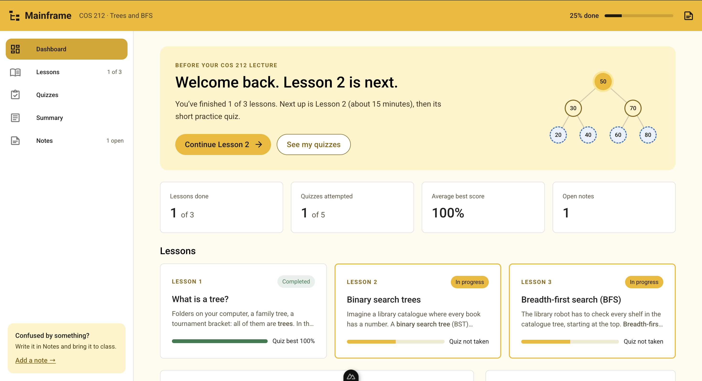

<div align="center">

# 🌳 MainFrame

### An interactive pre-lecture tutor for binary search trees, BFS and DFS

*Built for COS 212 – Data Structures and Algorithms, University of Pretoria*


[**Live demo**](#) · [Features](#-features) · [Getting started](#-getting-started) · [Team](#-team)

</div>

---

## 📖 About

**MainFrame** gives COS 212 students a tutor-style session *before* their lecture on trees. It assumes no prior knowledge. Students learn what a binary search tree (BST) is, then watch, step through and predict how **breadth-first search (BFS)** and **depth-first search (DFS)** walk through one.

A short diagnostic quiz places each student on the right path. A mastery quiz at the end checks understanding. Students who score below 70% on a concept get extra scaffolding (hints, worked examples and faded examples) before they retry. Anything still unclear goes into their notes to bring to the lecture.

The project was built for the **COS 750 – Educational Software Development** examination, 2026.

<!-- Replace with a real screenshot or GIF: save it to docs/screenshots/ and update the path -->
<div align="center">
  
</div>

## ✨ Features

| | Feature | What the student does |
| --- | --- | --- |
| 🧭 | **Diagnostic quiz** | Answers 5 short questions that set a standard or supported learning path |
| 📚 | **Three bite-sized lessons** | Learns tree terms, BSTs and traversals through a running library-catalogue example |
| 🔍 | **BST playground** | Inserts and searches values and sees every comparison highlighted |
| ▶️ | **Traversal stepper** | Steps forwards and backwards through BFS and pre-, in- and post-order DFS, with the live queue or call stack and highlighted pseudocode |
| 💡 | **Predict mode** | Taps the node they think comes next and gets instant feedback |
| ✅ | **Mastery quiz** | Orders nodes, builds trees and answers scenario questions on randomised trees |
| 🪜 | **Adaptive scaffolding** | Below 70%: hint → worked example → faded example → retry |
| 🏅 | **Progress and badges** | Sees mastery per concept and earns low-stakes, private badges |
| 📝 | **Lecture notes** | Collects questions to bring to class and downloads them as a `.txt` file |

**Accessibility:** works on phones from 360 px wide, supports keyboard navigation and screen-reader labels, and shows node states with shape as well as colour. **Privacy:** no sign-in and no personal data collected; progress stays in the browser's local storage.

## 🎓 Curriculum alignment

MainFrame covers these core topics from the ACM/IEEE **CS2023** Algorithmic Foundations knowledge area:

- **AL-Foundational 9:** Trees (binary, n-ary and search trees)
- **AL-Foundational 11c:** Depth- and breadth-first tree search
- **AL-Complexity:** How tree balance affects the efficiency of BST operations

## 🛠 Tech stack

| Layer | Tools |
| --- | --- |
| Framework | [Nuxt 4](https://nuxt.com) (SPA mode) · [Vue 3](https://vuejs.org) · TypeScript |
| UI components | [Vuetify 3](https://vuetifyjs.com) via `vuetify-nuxt-module` · Material Design Icons |
| Styling | [Tailwind CSS 4](https://tailwindcss.com) for layout and custom components |
| State | Nuxt `useState` + `localStorage` (`useProgress` composable) |
| Hosting | GitHub Pages |

## 🚀 Getting started

**Requirements:** [Node.js](https://nodejs.org) 20 or later (check with `node -v`).

```bash
# 1. Clone the repository
git clone https://github.com/TshwaneloNtjana/COS212-learning-App.git
cd COS212-learning-App

# 2. Install dependencies
npm install

# 3. Start the dev server at http://localhost:3000
npm run dev
```

### Other scripts

| Command | What it does |
| --- | --- |
| `npm run build` | Builds the app for production |
| `npm run generate` | Builds a static site for GitHub Pages (output in `.output/public`) |
| `npm run preview` | Previews the production build locally |

## 📁 Project structure

```
app/
├── app.vue                  # Root: wraps pages in the layout
├── assets/css/main.css      # Tailwind imports and MainFrame colours
├── composables/
│   └── useProgress.ts       # Progress, mastery, badges and notes (saved locally)
├── layouts/
│   └── default.vue          # App bar and "Your path" side menu
└── pages/
    ├── index.vue            # Home / overview
    ├── diagnostic.vue       # Diagnostic quiz
    ├── lessons/
    │   ├── trees.vue        # Lesson 1: What is a tree?
    │   ├── bst.vue          # Lesson 2: Binary search trees
    │   └── traversals.vue   # Lesson 3: BFS and DFS stepper
    ├── practice.vue
    ├── quiz.vue             # Mastery quiz
    └── summary.vue          # Results and lecture notes
nuxt.config.ts               # Vuetify theme, Tailwind plugin, SPA mode
```

## 📄 Documentation

The design rationale behind MainFrame is documented in two companion documents, submitted on ClickUP:

- **Software Engineering document:** Agile Scrum approach, requirements, architecture and testing
- **Instructional Design document:** ADDIE and Gagné's Nine Events, learning objectives, learning theories, motivation (ARCS) and assessment design

## 👥 Team

**Group:** MainFrame

| Name | Role | GitHub |
| --- | --- | --- |
| Melisa Ledwaba | Developer | [@Melissa941](https://github.com/Melissa941) |
| Tamsanqa Thwala |  | [@Tamsanqa743](https://github.com/Tamsanqa743) |
| Matlotlo Maphalela |  | [@mjmaphalela](https://github.com/mjmaphalela) |
| Lesedi Lebopa |  | [@username](https://github.com/) |
| Tshwanelo Ntjana |  | [@TshwaneloNtjana](https://github.com/TshwaneloNtjana) |

## 🤖 Use of generative AI

Generative AI (Claude, by Anthropic) assisted with planning documents, UI designs and parts of the code. All AI output was reviewed and edited by the team. Prompts and details are listed in the Instructional Design document, as the COS 750 specification requires.

## 📜 Licence

Created for academic purposes at the University of Pretoria, Department of Computer Science. Not for commercial use.
